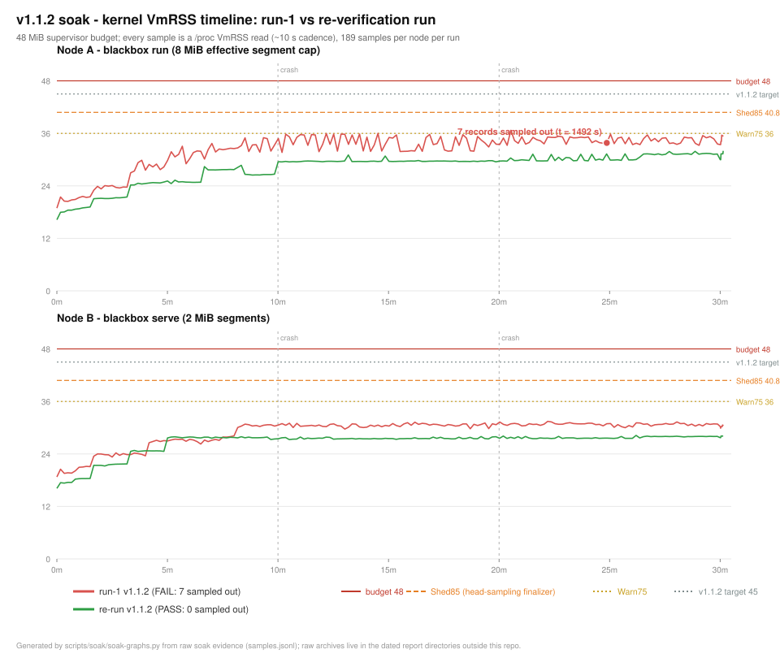
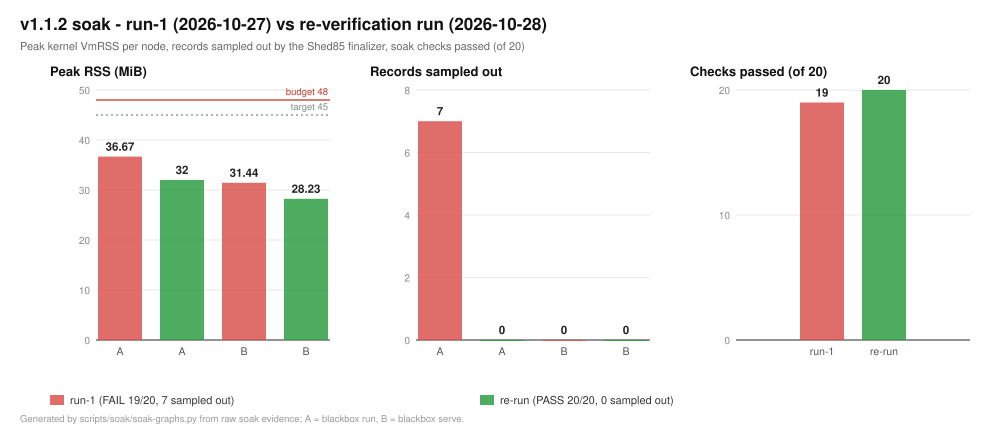

<div align="center">

[](https://github.com/fowzanasoftsolution/blackbox/actions/workflows/ci.yml)
[](https://github.com/fowzanasoftsolution/blackbox/actions/workflows/release.yml)
[](LICENSE)
[](https://www.rust-lang.org)
[](#verification)


</div>

# Project Blackbox — the Rust Omni-Sidecar

Authored by **Dr.wolfic** — maintained by **fowzanasoftsolution**.

**One ~17 MB static binary that replaces four layers of infrastructure** —
Sentry, Temporal+Redis, NGINX and your egress cache — by living beside your app
on a $5 VPS and recording *everything*, with zero code changes.

Docs: [fowzanasoftsolution.github.io/blackbox](https://fowzanasoftsolution.github.io/blackbox/)
(mdBook source in [`docs-src/`](docs-src/)).

```
                        ┌──────────────────────────────────────────────────────────┐
 your users ──HTTPS──►  │  BLACKBOX  (one static binary, 48 MB RAM budget)         │
                        │                                                          │
                        │  1 INGRESS      TLS termination · rate limit · WAF shield │
                        │                 reverse proxy · flight recorder          │
                        │  2 QUEUE        durable webhooks · leases · DLQ · replay  │
                        │  3 EGRESS       LLM coalescing · cache · cost ledger      │
                        │  4 STORAGE      segments → zstd → S3/R2 · self-healing    │
                        │                                                          │
                        │  supervisor: RAM/disk watermarks · auto-resurrection      │
                        └───────────────┬──────────────────────────┬───────────────┘
                                        │                          │
                                  your app (any language)      S3 / R2 cold tier
```

**Status (v1.1.3)** — 217 workspace tests green in release · **21/21
verification gates passing** · binary **17.18 MB** · 30-minute isolated soak
**20/20**: RSS peaks **31.8 / 28.3 MiB** (189/189 samples `Normal`, 0 sampled
out, 0 dropped), **98,444/98,444 webhooks delivered**, crash recoveries
**0.203 / 0.257 s**, cold reopen byte-equivalent · raw evidence and the
3-run comparison in [Verification](#verification).

## Install

```sh
curl -fsSL https://raw.githubusercontent.com/fowzanasoftsolution/blackbox/main/scripts/install.sh | sh
```

From source (Rust stable, no C toolchain):

```bash
git clone https://github.com/fowzanasoftsolution/blackbox && cd blackbox
cargo build --release --workspace && sudo cp target/release/blackbox /usr/local/bin/
```

Verify: `blackbox demo --once` exits 0. Docker: see
[Deployment snippets](#deployment-snippets).

## Try everything in 60 seconds

```bash
blackbox demo
```

Boots a self-contained topology (embedded shop app, LLM provider, mock S3) and
drives scripted traffic through all four engines, then leaves the live
dashboard running:

```
  B coalesced LLM calls … ok (1 upstream calls · 3818 saved tokens)
  C webhook burst … ok (40/40 delivered · 0 lost)
  D checkout bug → Sentry crash … ok (trace f15b… · IngressHttp 500 + SentryCrash)
  E bit-rot self-heal … ok (corrupt .zst → digest-verified cold restore)

  ┌──────────────────────── 4 ENGINES ────────────────────────┐
  │ 1 INGRESS       requests 112 · indexed 194 · traces 112  │
  │ 2 QUEUE         webhooks 40/40 delivered · DLQ 0         │
  │ 3 EGRESS-FINOPS LLM calls 24 → 1 upstream · 95.8% saved  │
  │ 4 STORAGE       uploads 4 · bit-rot heals 1              │
  └───────────────────────────────────────────────────────────┘
  dashboard: http://127.0.0.1:9690
```

`--once` runs the same scenario head-less and exits 0 — it is the Phase 7
acceptance gate and doubles as a deployment smoke test.

## Wrap any app — or serve in front of it

```bash
# the zero-config path: spawns + supervises your app, injects the env, survives crashes
blackbox run --upstream-port 3000 -- ./my-app

# the front-door path: your app already runs behind a process manager
blackbox serve --upstream 127.0.0.1:3000 --listen 0.0.0.0:8080
```

Your app wakes up with `SENTRY_DSN`, `OTEL_EXPORTER_OTLP_ENDPOINT`,
`OPENAI_BASE_URL`, `ANTHROPIC_BASE_URL` and `BLACKBOX_EGRESS_URL` pointed at
the sidecar. Crash or hang → the breaker trips, in-flight requests are
**held** (not 502'd), the app respawns with full-jitter backoff. Measured:
351,888 requests, **0 failures**, across two `kill -9` cycles mid-traffic.

**TLS without NGINX** — real certs hot-reload (polled every 2 s, atomic swap,
a corrupt half-written pair on disk never disrupts serving); a persisted
self-signed pair is generated with `--tls-self-signed`:

```bash
blackbox serve --upstream 127.0.0.1:3000 \
  --tls-cert /etc/letsencrypt/live/app/fullchain.pem \
  --tls-key  /etc/letsencrypt/live/app/privkey.pem
```

**Guard, on by default** — token-bucket rate limiting (sharded lock-free, 429 +
Retry-After in <50 µs, keyed `x-api-key` → `x-forwarded-for` → socket) answers
before your app or disk see the request (`--rps 50 --burst 100`, 0 =
unlimited). The scanner shield drops `/.env`, `/.git/*`, `wp-admin`, traversal
variants and friends with a bare 404, before the limiter or the writer;
blocked noise is never recorded (`--no-shield` disables).

## The four engines

1. **Ingress shield & flight recorder** — reverse proxy with W3C
   `traceparent` injection, streaming tee capture, wire-compatible Sentry
   `/api/{project}/envelope/` + OTLP ingestion, telemetry-copy PII scrubbing
   (raw records stay unscrubbed). 31,029 req/s with **p99 added latency
   166 µs**.
2. **Durable webhook queue (zero Redis)** — `/webhooks/*` gets a 202 in <1 ms
   after one group-commit, then lease-based delivery, backoff, breaker, 24 h
   idempotency dedup (HMACs byte-exact). **Deterministic replay**:
   `blackbox replay <trace_id> --target http://staging` re-runs a recorded
   request against any environment; unrecorded upstream calls are
   428-blocked in the sandbox.
3. **Egress FinOps proxy** — identical concurrent LLM calls coalesce into **one
   upstream request** (singleflight), byte-budgeted LRU cache, per-tenant
   cost ledger with token accounting. Measured: 24 identical calls →
   **1 upstream call, 95.8 % saved**.
4. **Storage lifecycle & self-healing** — append-only CRC32C segments rotate
   at the cap, compact to **zstd (measured 194×)** with `.idx` sidecars,
   sync to any S3-compatible bucket via a hand-rolled SigV4 client. Disk ring
   compresses at 75 %, FIFO-evicts cold `.zst` at 85 % (crash + 5xx segments
   pinned), sheds healthy telemetry at 95 % while crashes/queue jobs survive
   at 100 %. Bit-rot heals itself: an unreadable frame in a sealed `.zst`
   surfaces as `StorageError::Corrupt` and the digest-verified cold replica
   replaces the damaged file atomically.

## Pro differentiators

- **SimHash near-cache** (L1 behind the exact-match cache): near variants —
  key-order shuffle, punctuation, whitespace, a drifted order-id — are served
  **byte-identically** (`x-blackbox-cache: SIMHASH(d=0..3)`) after
  normalize → 3-shingles → FNV-1a → 64-bit Charikar SimHash, hit at Hamming
  ≤ 3 (`BLACKBOX_SIMHASH_MAXDIST=0` disables). Deterministic knobs only —
  temperature drift, different tenants, genuinely different prompts pay
  upstream. Measured: **1 upstream call answered a 1,001-request variant
  storm** at 3.4 µs/prompt.
- **Tamper-evident audit chain**: every queue/egress/replay/cold touch
  appends a SHA-256 hash-chained JSONL record; every 1,024 records fsyncs a
  checkpoint. Interior edits break the chain at their line; sort to external
  anchoring and truncation becomes detectable. Verify any time:

  ```bash
  blackbox audit verify --data ./data           # full recompute; exit 2 on tamper
  blackbox audit current-anchor --data ./data   # print seq:hash for external anchoring
  ```

  On by default (`BLACKBOX_AUDIT=0` escapes).

## Admin dashboard

```
http://<host>:9690/          live dashboard (no JS framework, one embedded HTML file)
GET /api/stats               ingress/queue/egress/storage/guard/cold/breaker JSON
GET /api/finops              per-tenant cost ledger rows + savings %
GET /api/queue               pending / in-flight / DLQ counts
GET /api/trace/<32hex>       flight-recorder view of one trace (+ 1-click replay cmd)
POST /api/egress/purge       drop the entire FinOps cache
```

Lock it down with `BLACKBOX_ADMIN_TOKEN` (sent as `x-admin-token`).

## CLI reference

```
blackbox run            wrap + supervise any app (injects the 5 env vars)
blackbox serve          full node against an already-running upstream
blackbox demo           self-contained 4-engine demo (--once for CI)
blackbox replay <tid>   deterministic replay; auto-clones into a scratch copy
                        against a live node, unrecorded egress is 428-blocked
blackbox queue status|retry-dlq        offline queue administration
blackbox audit verify|current-anchor   audit-chain verification (--data, --anchor)
blackbox self-update    Ed25519-verified canary update (auto-rollback)
blackbox keygen | sign-update          update signing tooling
blackbox harness | bench | p2..p7-gate verification harnesses
```

Flags that matter: `--listen` `--upstream` `--data` `--webhooks`
`--egress-listen` `--admin-listen` `--mem-budget-mb` `--max-segment-mb`
`--disk-quota-mb` `--rps` `--burst` `--shield/--no-shield` `--tls-cert`
`--tls-key` `--tls-self-signed`.

## Environment

| Variable | Effect |
|---|---|
| `BLACKBOX_ADMIN_TOKEN` | require `x-admin-token` on the admin API |
| `BLACKBOX_COLD_ENDPOINT` / `_BUCKET` / `_ACCESS_KEY_ID` / `_SECRET_ACCESS_KEY` | attach the S3/R2 cold tier (path-style; R2/MinIO compatible) |
| `BLACKBOX_COLD_REGION` (default `us-east-1`) | SigV4 region |
| `BLACKBOX_SIMHASH_MAXDIST` | near-cache Hamming budget (default `3`; `0` disables) |
| `BLACKBOX_AUDIT` | set `0` to disable the audit chain |
| `BLACKBOX_VERIFY_PUBKEY` | override the Ed25519 verifying key (`BLACKBOX_UPDATE_PUBKEY` honored as legacy) |
| `NO_COLOR` | plain demo/summary output |

## Data layout & watermarks

`<data>/` holds `segment_NNNNNN.log[.zst]` (+ `.idx`), `jobs.redb`,
`finops.redb`, `cold.redb`, the hash-chained `audit.log` and `tls/`. RAM on
the 48 MB budget: 75 % purge caches · 85 % head-sample healthy telemetry ·
95 % backpressure. Disk on the 4 GB quota: 75 % aggressive compaction ·
85 % FIFO-evict cold segments · 95 % survival shedding (crashes + queue jobs
always survive).

## Cold tier (S3 / R2 / MinIO)

```bash
export BLACKBOX_COLD_ENDPOINT=https://<acct>.r2.cloudflarestorage.com
export BLACKBOX_COLD_BUCKET=blackbox-cold
export BLACKBOX_COLD_ACCESS_KEY_ID=...
export BLACKBOX_COLD_SECRET_ACCESS_KEY=...
blackbox serve --upstream 127.0.0.1:3000
```

Sealed `.zst` + `.idx` pairs upload asynchronously (BLAKE3 + SHA-256 digests
recorded); evicted segments restore transparently on first touch; corrupt
local files heal from the bucket automatically.

## Self-update (air-gap friendly)

```bash
blackbox keygen --out-dir ./keys
blackbox sign-update --key ./keys/blackbox_ed25519.key --input ./blackbox.new --out update.sig
blackbox self-update --from ./blackbox.new --sig update.sig
```

Signature verify → redb snapshot → isolated canary boot (scratch data dir,
real `/healthz`) → promote/rollback; exit `2` = rejected signature, `3` =
rolled back. The verifying key resolves `--pubkey` > `BLACKBOX_VERIFY_PUBKEY`
> legacy env > `<data>/update.pub` > the compiled-in official key
(`77b44dc4dd7f50fef3dc959963050fb490e78a15a438aed18418ce2109a1f153`).
Enterprise forks bake their own with `BLACKBOX_RELEASE_PUBKEY=<64 hex>`.

## SDK compatibility

`scripts/sdk_matrix/` proves the wire contracts against the **official**
`sentry-sdk` / `openai` / `@sentry/node` clients on a real FastAPI app
launched by `blackbox run` — no code changes, injected env only. Pinned
behaviors (frozen as Rust regression tests, run in CI on every push):
sentry-trace injection, brotli envelope decoding, replay form, and W3C
`baggage` trace-id parity.

## Deployment snippets

**systemd** (`/etc/systemd/system/blackbox.service`):

```ini
[Unit]
After=network-online.target
[Service]
ExecStart=/usr/local/bin/blackbox run --listen 0.0.0.0:8080 \
  --tls-cert /etc/ssl/app/fullchain.pem --tls-key /etc/ssl/app/privkey.pem \
  --rps 100 --burst 200 --data /var/lib/blackbox -- ./my-app
Restart=always
LimitNOFILE=65536
[Install]
WantedBy=multi-user.target
```

**Docker** (static binary, no runtime deps):

```dockerfile
FROM debian:bookworm-slim
COPY blackbox /usr/local/bin/blackbox
COPY my-app /srv/app
EXPOSE 8080 9690
CMD ["blackbox", "run", "--listen", "0.0.0.0:8080", "--data", "/data", "--", "/srv/app"]
```

## Verification

Gates live in `crates/*/src/gates_phase<n>.rs` and
`crates/*/tests/phase<n>_gates.rs` — every gate is also a CI test. Run any
gate directly (`blackbox p1..p7-gate <n>`), or the whole battery:
`cargo test --workspace --release` (217 tests) + `blackbox demo --once`.

| Phase | Proves (measured) |
|---|---|
| 1 | torn write / bit-flip / kill -9 recovery — PASS, crash-pinned fsync discipline |
| 2 | causal chain + PII redaction · 50 MB stream (bombs 413) · **31,029 req/s, p99 Δ166 µs** |
| 3 | **5,000/5,000** HMAC-intact webhooks · 43,973 reqs, 0 failures across a real app kill · replay 200-exact + 428 sandbox |
| 4 | singleflight 96 % saved · poisoned responses never cached · **1 upstream call for 1,001 near variants** (3.4 µs) · chain tamper hash-breaks at the edit line |
| 5 | **194× zstd** + cold replay via the real CLI · **351,888 req, 0 failures** over 2 kill -9 · 106,007-op soak, index == disk |
| 6 | cold tier + tiered eviction with crash pinning · 3 bit-rot heal rounds digest-verified · tampered canary rejected in 30 ms |
| 7 | **5/5 burst + 5× 429**, 6 scanner paths 404'd, 0 frames recorded · TLS hot reload, 12 req 0 failures · `demo --once` exit 0 in **3.1 s** |

Budgets: binary **17.18 MB** (red line < 21 MB) · idle RSS ≈ 18 MB ·
load RSS 33.1 MB.

**30-minute isolated soaks** (1 CPU / 1 GiB cgroups, identical harness; the
third run's kernel is newer, so sub-MiB cross-run RSS comparisons are
approximate):

| Metric | run-1 | re-run | v1.1.2c |
|---|---|---|---|
| Verdict | FAIL — 19/20, sampled-out | PASS — 20/20 | **PASS — 20/20** |
| RSS peak A / B | 36.67 / 31.44 MiB | 32.00 / 28.23 MiB | **31.82 / 28.29 MiB** |
| HTTP requests | 267,589 | 269,324 | **267,440** (148.6 req/s, 0 errors) |
| Compactions / frames | 18 / 266,632 | 18–37 / 401,608 | **54 / ~398 K** |
| Crash recoveries | verified | 0.256 / 0.357 s | **0.203 / 0.257 s** |
| Cold reopen | PASS | PASS | **3/3 byte-equivalent** |

`0 sampled-out` because RSS never left `Normal` — when a node *is* squeezed,
healthy telemetry sheds first and errors/crashes/queue jobs stay at 100 %,
exactly as the gate harnesses pin. The FAIL run and its fix narrative are the
point of this table: [docs/soak/V1.1.2-COMPARISON.md](docs/soak/V1.1.2-COMPARISON.md),
raw evidence hashed in the dated soak report directory outside the repo.




Charts regenerate deterministically via `scripts/soak/soak-graphs.py`.

## Repository layout

A Cargo workspace of eight crates:

| Crate | Contents |
|---|---|
| `crates/blackbox` | CLI binary: node assembly, ops, demo, dashboard, gates |
| `crates/blackbox-core` | storage engine: frames, schema, segment store, compactor, breaker, queue actor, audit chain |
| `crates/blackbox-ingress` | reverse proxy, tee capture, scrubber, WAF, rate limiter, TLS, trace index |
| `crates/blackbox-queue` | durable jobs: leases, dispatcher, reaper |
| `crates/blackbox-telemetry` | Sentry envelope + OTLP wire formats |
| `crates/blackbox-egress` | gateway, singleflight, cache (L0 + SimHash), finops ledger |
| `crates/blackbox-cold` | hand-rolled SigV4, S3/R2 tier policy, mock bucket |
| `crates/blackbox-supervisor` | RAM/disk watermark monitors, process supervision |

## Contributing

See [CONTRIBUTING.md](CONTRIBUTING.md) — build protocol, gate inventory and
the commit convention. PRs that regress any gate fail CI by construction.

## Security

See [SECURITY.md](SECURITY.md) — vulnerability reporting (GitHub private
reporting only), supported versions, release-signing discipline.

## License

Apache-2.0 — see [LICENSE](LICENSE). Copyright © 2026
**Dr.wolfic** (fowzanasoftsolution).

---

<div align="center">

**A little coffee, a lot of love. ☕ 💛**

If Blackbox makes your day a little easier, you can help fuel the next build.

[](https://buymeacoffee.com/zuhayfaja)

</div>
